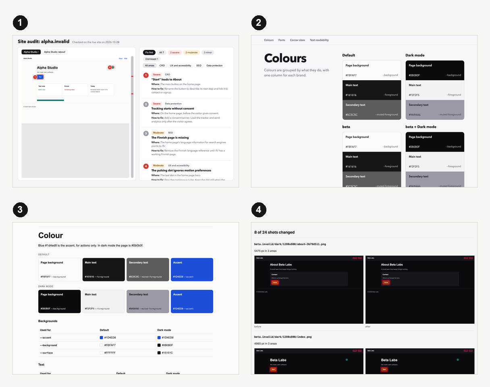
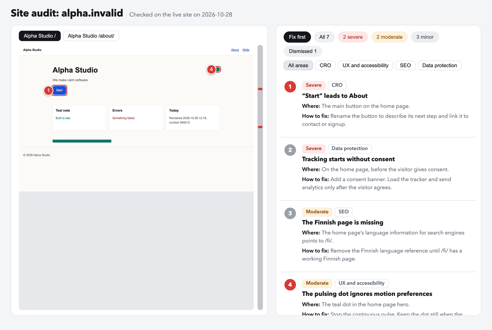
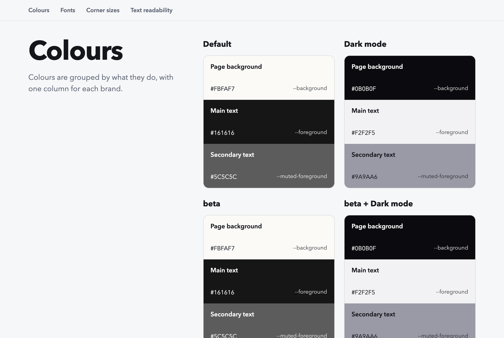
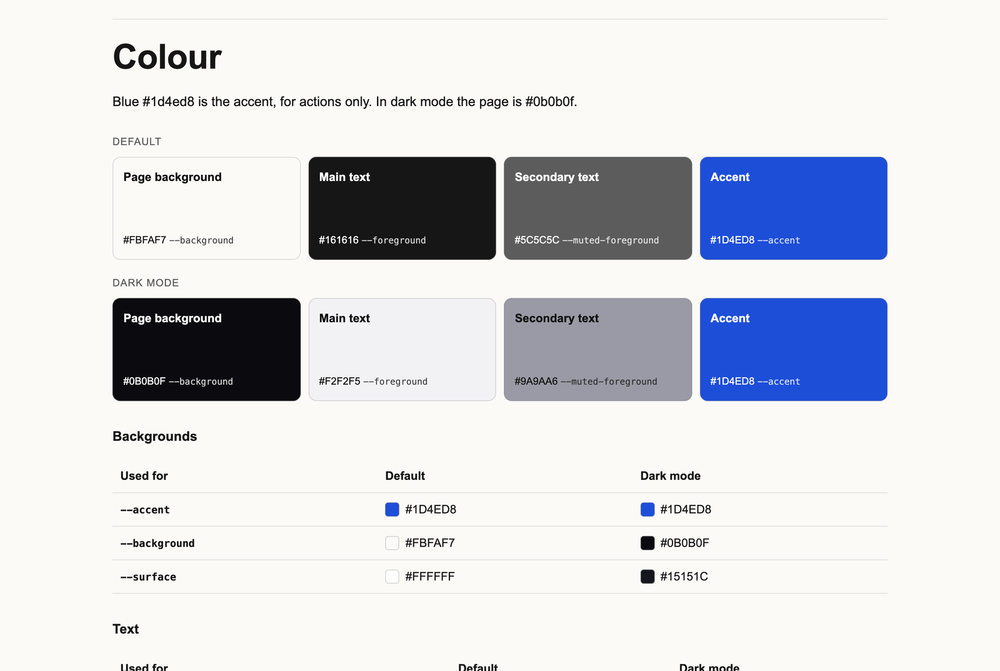
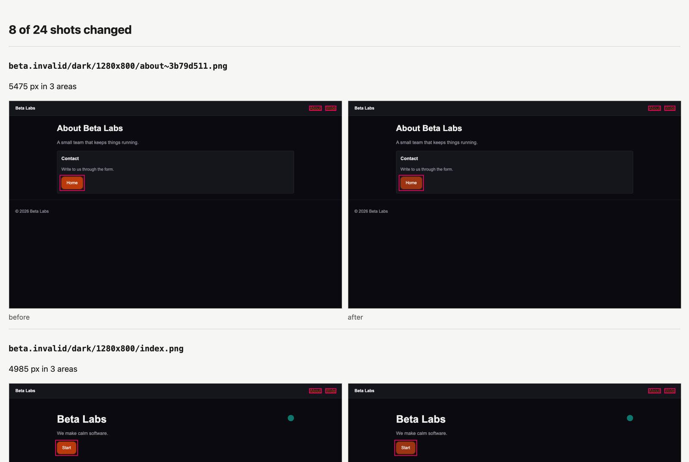
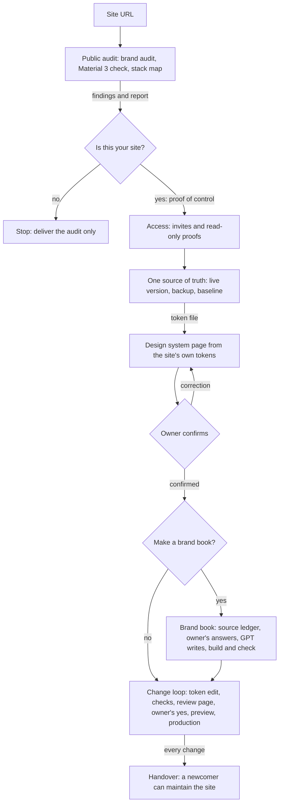

# The Ex-Designer

## Your designer left. Your design system left with them.

Imagine finding out your spouse has been cheating on you with your designer.

Awkward.

You fire the designer. They walk away with the Figma files, brand guidelines, design tokens, and every last bit of
documentation.

Your spouse? Well, that's a different problem.

Now you're left with a website, a logo, and absolutely no idea how any of it was built.

**Meet The Ex-Designer, the skill that picks up where your designer left off.**

Give it a URL. It audits your existing website as a visitor sees it. To go further, it needs proof that the site is
yours, or written permission from your client. It also needs access to the site's code through an invite to your own
account. It never asks for passwords.

It reads the code and the site's token file, where the colors and fonts live. From those, it builds a design system
page, a brand book, and tokens.json, a standard token file other tools can read.

It can also audit an existing design system and identify inconsistencies. Every change is tested on a local copy:
screenshots compared pixel by pixel, readable contrast, and SEO. Changes go live only after your yes. It also writes the
files a new person needs to maintain the site without the skill.

**No Figma files. No documentation. No designer. A URL to start. Code access to go further.**

The Ex-Designer is a Claude Code skill. It makes you the new maintainer of an existing website, and you continue to
develop the site in its current design.



All pictures in this README come from the skill's own scripts. The scripts ran on an invented two-brand site, Alpha
Studio and Beta Labs, in `tests/fixtures/`. No real site or client is in them.

## From one link to a handover

### 1. The audit

You write `/ex-designer example.com`. The skill reads the site as a visitor sees it and audits it with two skills:
[`objective-brand-audit`](https://github.com/BuildexLabsAI/objective-brand-audit) for the brand and `material-3` for Material 3 and
WCAG faults. It also makes a list of the systems that the site uses: hosting, DNS, the domain registrar, mail, forms,
third-party scripts and font licenses.

The audit report shows a full-page screenshot of each page that has a finding on it. Each finding has a number on
the element that it is about. The list opens on the findings to fix first.



The example report has 7 invented findings, and 4 of them are on the "Fix first" list. A grey number is a finding
without a place on the page, for example a tracker that loads before consent. The "Dismissed" tab lists the
items that an automatic check flagged, but that are not faults.

### 2. Ownership and access

Next, the skill asks one question: is this your site? You answer with a digit:

```
1 mine · 2 a client's, with written permission · 3 no
```

If the answer is 3, the skill gives you the audit and stops. If the answer is 1 or 2, you show control. To do this,
open the account that holds the site in your own session: the code repository, the hosting or the registrar. Your
answer alone is not the proof. For a client's site, the skill also keeps the written permission as a file.

Then the skill makes a list of the access that you need. It never asks for a password, a key or a token, and you do
not type them into the chat. Each row of the list gives:

- why the takeover needs this access,
- the safest way to get it: the owner invites your own account, for example as a GitHub collaborator or as a
  Cloudflare member with a limited role,
- a read-only proof that the access works, for example `gh repo view`.

### 3. The live version and the safety net

The skill finds the version of the site that is live and the commit that it came from. It builds that commit and
proves that the build is the same as the live site.

The work happens in the site's code, not in Figma or in a website builder. The skill gets the code repository on
your Mac and works on its own branch, `takeover/<name>`, in Claude Code. The site stays on its own hosting, for
example Cloudflare, Vercel or Netlify. In version 1, a site on a builder (Framer, Webflow, WordPress, Wix or
Squarespace) gets only the audit and the access list.

Then the skill makes the safety net:

- a backup,
- screenshots of every page, host, size and mode, in 3 identical runs,
- the SEO facts of every URL: status, title, description, canonical, robots, hreflang and the sitemaps.

### 4. The design system page

The skill reads the site's own token file and makes a design system page from it. The page shows each color by
role, with one column for each brand and mode, and the fonts, type sizes, corners and readable text pairs. A second
file, `usage.json`, gives the file and the line where the code uses each value.



The token file stays the only place where design values live. The skill generates the page and `tokens.json` from
it, and nobody edits them. Then the skill asks you questions about the page, one question in each message, until you say
that all of it is correct.

### 5. The brand book

The skill offers a brand book. If you say yes, it reads the copy and the brand files of the site into a source
ledger. It asks you only about the gaps. For example, who the brand is comes from you, never from a guess. GPT
writes the text through the `copywriting` skill. A script then checks that each fact in the book has a source that
it can find.



The output is a kit for the people who make things for the brand: `brand-book.md` for AI tools, `brand-book.html`,
`brand-book.pdf` (11 pages for Alpha Studio) and the logo files.

### 6. The change loop

Each design change goes through the token file only. After each edit, `verify.py` compares the local build with the
safety net from step 3. You see a review page that shows only the screenshots that changed, with the changed areas
outlined.



In the example, the Beta Labs accent changed from `#b93a0b` to `#9a3412`. 8 of 24 shots changed, and all 8 are on
`beta.invalid`. The Alpha Studio pages did not change. A change must pass all of these checks:

| Check | It fails when |
|---|---|
| Project checks | the site's own commands, such as `npm run lint` and `npm test`, fail |
| Tokens | the code has a new color or font outside the token file |
| Contrast | a foreground and background token pair that passed WCAG AA (4.5:1) before is below 4.5:1 now |
| Pixels | with `--expect-hosts`, a screenshot changed on a host that is not on that list |
| Layout and status | a page has new sideways overflow, or a page that answered 200 now gives an error |
| SEO | a title, description, canonical, robots or sitemap fact is different from before |

After the checks, you say yes to the preview. Then you say yes to production, in a separate step. Then the skill
checks the live site and keeps a rollback ready.

### 7. The handover

At the end, the skill writes `CLAUDE.md`, `systems.md` and the design system page into the site's project, and
copies its scripts into `tools/`. With these files, a new person can maintain the site without the skill. A test
gives the handover of the invented site to a new Claude Code agent and scores its work.

## Install

```bash
git clone https://github.com/BuildexLabsAI/ex-designer.git
mkdir -p ~/.claude/skills
ln -s "$PWD/ex-designer/src/ex-designer" ~/.claude/skills/ex-designer
```

Start a new Claude Code session after you install it. Only the `src/ex-designer/` folder becomes the skill. The other
files in this repository are not part of it.

## Usage

Type the slash command with the address of the site:

```
/ex-designer example.com
```

You can also write the request in your own words, in English or Finnish. The skill starts when the request names
it ("The Ex-Designer", "ex-designer" or its old name "snatcher"), or asks to continue or look after a site:

```
ex-designer example.com
jatka example.com kehitystä
ylläpidä example.com saittia
```

The skill also starts in a site project that already has `tools/site.json` or `design/system.html`.

The skill asks one question at a time, and you answer with a digit. It stops at each step that needs your decision.

You can also run the scripts without Claude. Most of them read the project's `tools/site.json`, and `--help` gives
every option. Run them from the site's project folder. The local build of the site must run at the `serve.url` of
`tools/site.json`.

Do these steps once, before the first change. They make the design files and the baseline:

```bash
python3 ~/.claude/skills/ex-designer/scripts/tokens.py extract --site tools/site.json --out design/
python3 ~/.claude/skills/ex-designer/scripts/tokens.py page --site tools/site.json --design design/ \
    --labels ~/.claude/skills/ex-designer/templates/ui-labels.json --lang en
python3 ~/.claude/skills/ex-designer/scripts/shoot.py --site tools/site.json --out baseline/shots --runs 3
python3 ~/.claude/skills/ex-designer/scripts/livecheck.py seo --site tools/site.json --out baseline/seo.json
```

After each edit of the token file, compare the site with the baseline. Do not make the baseline again:

```bash
python3 ~/.claude/skills/ex-designer/scripts/verify.py --site tools/site.json --baseline baseline/ --design design/ \
    --out review/
```

The brand book needs a work folder with `brand.json`, a source ledger, the owner's answers and the written book.
`src/ex-designer/references/brand-book.md` gives the format. When the folder is complete, run:

```bash
python3 ~/.claude/skills/ex-designer/scripts/brandbook.py check --work brand-work/
python3 ~/.claude/skills/ex-designer/scripts/brandbook.py build --work brand-work/
```

`src/ex-designer/references/code-site.md` gives the format of `tools/site.json`.

## What it does



- **Audit:** reads the site as a visitor, with `objective-brand-audit` and a separate Material 3 and WCAG check from
  the `material-3` skill. Only real faults, such as low contrast, become findings.
- **Stack map:** lists hosting, DNS, the registrar, mail, forms, third-party scripts and font licenses. It also lists
  the files and values that a rebuild needs but Git does not hold.
- **Ownership gate:** asks if the site is yours, and asks for proof by control.
- **Source of truth:** finds the live version and proves that a local build of it is the same.
- **Safety net:** makes a backup, screenshots of every page (3 identical runs) and the SEO facts of every URL.
- **Design system:** makes a page from the site's own token file, and asks you to confirm it.
- **Brand book:** offers a brand book in which each fact has a source that a script checks.
- **Change loop:** changes the design through the token file only, with the checks above, your yes, a preview and a
  rollback.
- **Handover:** writes `CLAUDE.md`, `systems.md`, the design system page and the scripts in `tools/`.

## What it does not do

- It does not redesign. The site's confirmed tokens have priority over audit opinions.
- It does not start a takeover without proof of control. For a client's site, it also needs the owner's written
  permission.
- It does not copy, mirror or rebuild a site without the owner's permission. On such a site, it gives the audit and
  stops.
- It does not deploy, push or send anything without your clear yes for that step.
- It does not handle passwords, keys or tokens. You type them yourself.
- It does not test the security of the site. It does no port scans, probes or load tests. The only scan is a local
  scan of the repository for secrets.
- In version 1, only sites with code in a Git repository get all the steps. Sites on Framer, Webflow, WordPress, Wix
  or Squarespace get only the audit and an access list.

## Requirements

- Google Chrome in `/Applications`. The scripts use it for screenshots and for the brand book PDF.
- Python packages: `playwright`, `Pillow`, `numpy`, `markdown` and `pypdf`.
- The skills [`objective-brand-audit`](https://github.com/BuildexLabsAI/objective-brand-audit) and `material-3` for the audit, and
  the `copywriting` skill for the text that people read.
- `objective-brand-audit` writes reports only in English. If you select the full report in the audit step, the report
  is in English.
- `gh` for sites on GitHub, `npx wrangler` for sites on Cloudflare, and `gitleaks` for the secrets scan.

## Run it locally

The tests use the invented two-brand site and do not use the network:

```bash
cd ex-designer
bash .github/scripts/check-standard.sh
python3 tests/run_all.py
```

`run_all.py` takes about 8 minutes and opens Chrome a few hundred times. All 16 checks must pass.

The newcomer test gives the handover of the invented site to a new Claude Code agent and scores its work. It takes
about 15 minutes. It uses your Claude Code usage limits:

```bash
python3 tests/newcomer/newcomer.py run tests/newcomer/runs/my-run
```

To make the pictures of this README again, run this command. It takes about 2 minutes and prints the numbers that
this README gives:

```bash
python3 scripts/readme_images.py
```

## Deploy

There is no server. To install the skill, link `src/ex-designer/` to `~/.claude/skills/ex-designer` (see Install). A
`git pull` updates the installed skill.

## Media and large files

The README pictures are in `docs/images/`, about 1 MB in total. `scripts/readme_images.py` makes them. The invented
site in `tests/fixtures/` also has small image and font files for the tests. There are no large files.

## First-time setup

Once per clone, activate the check that runs before every commit:

```bash
git config core.hooksPath .github/hooks
```

## License

MIT. See [LICENSE](LICENSE).

## Owner

@eskokoivula
